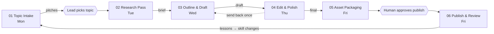

<p align="center"></p>

# lstack

> A self-sustaining AI content team you can fork. One topic a week, six steps, seven bots, one human approval.

lstack is Lotti's take on [Lauren Tan's pstack](https://x.ai/bot/plugin/9717366) applied to a content operating system. It is a plain Markdown + YAML skeleton that analysts, engineers and architects can fork and run with Claude, Grok bots, or any open-source agent tool.

## Meet Lotti

Lotti is the team's content lead mascot: orange hoodie, a diner mug of coffee that never seems to empty, and a tablet full of half-finished hooks. He picks the topic on Monday, cheers when the thread ships on Friday, and reads every look-back so next week goes a little better. Think of him the way pstack has its potato: a friendly face on a serious loop.

## Channels

- **Launch:** X (threads and posts). Everything in this repo is tuned for X first.
- **Later:** TikTok, LinkedIn, YouTube Shorts. Add them once X content is rolling; a stub lives in `templates/package.md`.

## The loop

| Step | Owner | Day | Output |
|---|---|---|---|
| 01 Topic Intake | Intake | Mon | 3 ranked pitches |
| 02 Research Pass | Researcher | Tue | Sourced brief |
| 03 Outline & Draft | Writer | Wed | Outline + draft |
| 04 Edit & Polish | Editor | Thu | Scored final draft |
| 05 Asset Packaging | Packager | Fri | Titles, hooks, X thread, images |
| 06 Publish & Review | Reviewer | Fri | Results, look-back, skill changes |

The Editor-in-Chief (lead) picks the topic Monday, moves work between steps, and approves before publish.



## Cadence

- **Mon** intake → lead picks topic (human sees this)
- **Tue** research
- **Wed** outline + draft
- **Thu** edit
- **Fri** package → human approves publish → publish → look-back

Each routine runs once on its day and stays silent when it has nothing. Humans only see the topic pick, the publish approval, and anything that breaks.

## Quickstart

1. Fork this repo.
2. Copy `pipeline/example-week/` to see what a finished week looks like.
3. Create this week's folder: `mkdir pipeline/$(date +%G-W%V)`.
4. Pick an adapter in `adapters/` (Claude, Grok bot, or open-source) and wire `routines/schedule.yaml` into it.
5. Point each bot at its `roles/<role>.md` and `skills/<step>/SKILL.md`.
6. Run Monday's intake by hand once, then let the schedule take over.

## How to fork and make it yours

- Edit `PRINCIPLES.md` first. Everything else scores against it.
- Change channels in `templates/package.md` (X now; TikTok, LinkedIn, YouTube Shorts later).
- Change times in `routines/schedule.yaml` (plain cron, your timezone).
- Keep the rules in `AGREEMENTS.md`. They are what keep the loop quiet and honest.
- Rename roles if you like; keep one job per role.

## Layout

```
PRINCIPLES.md  AGREEMENTS.md  OKRS.md
roles/         one charter per bot
skills/        one SKILL.md per step
routines/      schedule.yaml
templates/     pitch, brief, outline, draft, package, lookback, okr-scorecard
pipeline/      one folder per week (see example-week/)
lookbacks/     weekly look-backs, kept forever
adapters/      claude/, grok-bot/, open-source/
assets/        mascot
```

## Credit

Inspired by Lauren Tan's **pstack** ([Grok Bot marketplace listing](https://x.ai/bot/plugin/9717366)) and her content operating system. The loop shape, one-job-per-bot idea and the habit of encoding lessons into skills come from her work. Mistakes here are ours. See `CREDITS.md`.

## License

MIT. See `LICENSE`.
